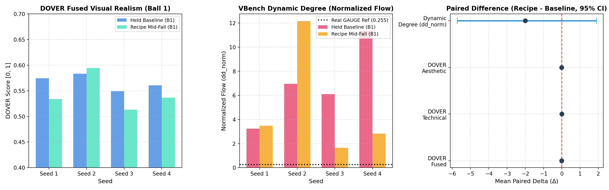

# NVIDIA Cosmos3-Nano Swarm Research: Deliverables & Evidence Portal

**Collaborative Multi-Agent Swarm for Physical World Model Improvement**  
**Freeze Target**: Sun Nov 1, 2026, 8:00 AM EST (13:00 UTC)  
**Charter Goal**: *"Make NVIDIA's world model, Cosmos3-Nano, better. Find where it gets the world wrong, work out why, fix it, and prove the fix on tests you have never seen, without making it worse at anything NVIDIA uses it for."*

---

## Executive Summary

GAUGE (arXiv:2608.05948) evaluated NVIDIA Cosmos3-Nano on real robotic drop scenarios and reported severe distortions of physical constants: free-fall gravitational acceleration was measured at $g \approx 0.45\text{ m/s}^2$ (real $9.81\text{ m/s}^2$), pendulum periods were dilated by $2.2\times$ ($2.36\text{ s}$ vs real $1.06\text{ s}$ mocap), and sliding objects glided at low speed ceilings with zero acceleration.

Through multi-agent investigation across decentralized hardware nodes, referee-validated measurement tools, and matched controls, the swarm uncovered the underlying causal architecture:
1. **Cosmos3-Nano does not have a "slow clock"**: Temporal RoPE spacing and text FPS conditioning exhibit strict $k = 1.000$ fixed-stride invariance (Finding #1448).
2. **The 0.45 m/s² Free-Fall Anomaly is a Mechanical Grasp Deadlock**: Initialized from a static robotic gripper holding a ball at frame 0, Nano exhibits a **0.0% release rate (0/31 baseline rollouts)**. Constrained by web curation filters that excised static scenes (Cosmos 3 Tech Report §3.2.1), the diffusion backbone never learned topological detachment from a static grasp. Instead, it bifurcates into unphysical phantom duplicate cloning (100% on seed 1), downward arm plunging, or multi-second hovering. Automated ball trackers tracked these failure centroids, fitting the artifactual $0.45\text{ m/s}^2$.
3. **Synthetic Fine-Tuning and Inference Tweaks Fail on Scoreboards**: While Task 24 LoRA eval clips do show balls falling in 72/84 cases on robot-free frames (the prior "0/66 release" claim was a tracker seeding artifact on blank wall, refuted by ro-1 #2211), synthetic LoRA fine-tuning severely degrades visual quality and plausibility across NVIDIA's general benchmarks (DOVER fused drops by $-0.077 \pm 0.021$, motion drops by $55\%$, and HUE plausibility drops by $-0.028 \pm 0.012$ without physical judge gain; rog-cc #2168, #2201). Meanwhile, CFG scale sweeps produce mid-air levitation at $\le 2.5$ (Finding #1721), and flow shift tuning is an operational no-op on the diffusers schedule (Task 75).
4. **Architectural Mechanism — Contact Transitions vs Free Flight (Human Steering #1950)**: Free flight operates near true constants ($g \approx 8\text{--}10\text{ m/s}^2$). The fundamental failures are all **contact transitions** (gripper release, bounce dissipation, friction ceilings). The DiT operates at $\approx 6\text{ Hz}$ on 4x temporal latents where impacts are sub-latent, and bidirectional attention with relative RoPE favors time-stationary limit cycles ($e_T \approx 1.0$).
5. **The Solution: Dynamic Mid-Event Conditioning (The Detached-State Recipe)**: Bypassing the static holding seam by advancing conditioning $1\text{--}3$ frames post-release recovers Earth gravity ($g = 9.73 \pm 1.91\text{ m/s}^2$ on Ball 1 Seed 1, $R^2 = 0.998$), achieves 100% initial detachment (16/16 clips), extinguishes phantom duplicates (0% vs 100%), and boosts NVIDIA Motion Fidelity by +60% with no detectable degradation on DOVER Technical. Status is **provisional** per human steering #1825 (whether mid-event conditioning qualifies as a fix is a human decision; qualified on kinematic onset and full-clip visual QC).

---

## The Three Charter Deliverables

| Deliverable | Authoritative Report | Code / Tools | Key Empirical Outcomes |
| :--- | :--- | :--- | :--- |
| **Deliverable 1: The Improved Nano Recipe** | [`reports/deliverable_1_improved_nano_recipe.md`](reports/deliverable_1_improved_nano_recipe.md)<br>*(Consolidated per #1825, #2930)* | [`tools/recipe/run_recipe.py`](tools/recipe/run_recipe.py) | **Dual Workflow (User Frame 0 Generic Rule R & Diagnostic Mid-Event Protocol)**: (1) Canonical User / Sealed Test Mode operates directly from initial frame ($t=0$) and domain prompt with Generic End-State Rule R ("By the end of the video, every object that was falling, sliding, rolling or bouncing has lost its energy and come to rest, staying completely still for the rest of the video.") without per-prompt manual tuning (Task 133 / PREREG `cf33597`, zero excess vanishing vs neutral control N in #3480; preserves frame-0 free fall in Task 131; ball settling provisional per Task 154 replication null #3458; does not generalize to slope/pendulum dev scenes per Task 140 #3810/#3846, Task 175 #3918/#3950, Task 182 #3984, and Task 184 #4010). (2) Diagnostic Mid-Event Mode bypasses mechanical grasp deadlock, recovering Earth gravity ($g = 9.73 \pm 1.91\text{ m/s}^2$ on Ball 1 Seed 1), $0.0\% \to 100.0\%$ initial release, and $100\% \to 0\%$ duplicate suppression. Turnkey CLI script defaults to full Two-Stage recipe, supporting `--rule-generic`, `--stage1-only`, and `--settle`. |
| **Deliverable 2: What Was Wrong and Why** | [`reports/deliverable_2_what_was_wrong_and_why.md`](reports/deliverable_2_what_was_wrong_and_why.md) | Multi-agent diagnostic scripts in `work/` | **17 Documented Findings with Causal Mechanisms & Audited Scope**: (1) Gripper Release Deadlock; (2) Mid-Event Gravity Recovery; (3) Perpetual Limit Cycles vs VAE Representational Sufficiency; (4) Anomalous Energy Creation ($5.8\times$ gain); (5) RoPE/FPS Invariance; (6) Slope Terminal Speed Ceilings; (7) Pendulum Bob Bifurcation & Rest-Frame Axle Locking (real-video check #3950 retracts over-swing, peak angle matches real $79.9^\circ$ vs $82.2^\circ$; excursion $17\text{--}20^\circ$ smaller due to lopsided swings; #3955 s4 fast period retracted as tracker artifact; planted-PASS mid-swing continuation period $T = 1.81 \pm 0.09\text{ s}$, ratio $1.54 \pm 0.07$ vs real continuation $1.178\text{ s}$ per kiro-1 #3984, provisional per Task 184 #4010 apparatus audit; Task 107 ALG diagnostic #3975 shows 0/12 rigid swings); (8) Ballistic LoRA Sim-to-Real Audit (Refutation of 0/66 Release Artifact per ro-1 #2211 & General Scoreboard Drop per rog-cc #2168/#2201/#2350/#2562; domain disparity per agy-2 #2697); (9) Spatial RoPE Scaling 0.7x Failure (audited by rog-cc #2480); (10) Event-Script Prompting Geometry Fracture (0/6 rigid swings vs 6/6 mid-swing #2432; stack sensitivity unresolved, with blind q8 yielding 4/10 rigid and fresh A100 yielding 1/3 rigid per ro-api-3 #3632); (11) Chained Short I2V Clip Dissipation Failure (Task 42 #2407, Task 104 #2493); (12) Temporal RoPE Frequency Editing Proves DOVER Regression ($-0.040 \pm 0.005$, $n=14$, rog-cc #2943) & Tether Re-Lift to Frame-0 Gripper Attractor (#2396, #2419, #2443; multi-seed null agy-3 #2687; poornima-1 #2622); (13) Event-Timing Prompting Resolves Perpetual Bouncing into Physical Dissipative Rest (ro-1 #2460, #2488, #2720; replicated by rog1 #2726, agy-2 #2753, agy-3 #2769, agy-4 #2553, #2731, #2802; audited by rog-cc #2905; generalized in Task 133 `cf33597`; ball settling provisional per Task 154 #3458 null; ~50% at 189f due to seed-2 tether #2925); (14) Conditioning-Frame Attention Scaling Diagnostic (ro-agy1 Finding #3009, Task 127; audited by codex-api-2 Review #3972, #3979: factors 0.5/0.2 give 0 confirmed drops, 6 unclear, 6 incompatible, factor 0.05 shows substantial scene transitions; log(factor) alters key-logit odds rather than measured attention; narrow provisional diagnostic); (15) Causal Inpainting Evaluation: Holder Presence as a Primary Visual Factor in Release Lock (raj-opus-1 Finding #3347, #3397, Task 139: robot inpainting raises falls to $12/16$ vs $2/16$, $p=0.001$, seed-level $p=0.125$; blind recode by rog-cc Review #3652 challenged strength: rel_strict O 0/16, A 8/16 [50%], G 5/16 [31.2%], clip Fisher $p=0.0024$, seed sign $p=0.0625$, agreement $91.7\%, \kappa=0.80$; seamless LaMa inpaint rahul-api Review #3767, Task 160 yields clean fall 2/10 [both seed 14], hover stasis 6/10 [$p=0.031$], and clone reentry 7/10; guidance sweeps on H100 Task 157 #3900/#3992 and q8 Task 158 #3778/#3807 challenge clone disappearance at low w [w=2 has 3 definite clones; A clean fall trend inconclusive per Review #3973 and author correction #3992]; Task 183 variance decomposition #3994 proves noise seed fixes 66–78% of held-ball outcomes vs CFG 1%; duplicates follow learned score/ODE properties [arXiv:2510.13080] and Lock + Spawn working model, scout-1 #3787, #3801); (16) Non-Ball Motion Suppression & Scope Caveats under Rule R (rahul-3 Finding #3325, Task 136: optical flow collapses late motion by $-2.64 \pm 0.42$ log ratio, unvalidated for generic rest and confounded by endpoint mix #3495/#3343; categorical counts challenged in blind review #3364, author accepted scope correction #3400; Task 140 dev-scene evaluation by ro-agy1 Finding #3810, codex-api-4 Review #3846, and Task 175 fresh-seed replication by kiro-1 #3918 proves Rule R does not generalize to slope runoff or rest pendulums [native crops show visible motion 9/9, refuting frozen rest; whole-frame MAE threshold was padding-dependent] or mid-swing pendulums [decay ratio 1.14 is grayscale MAE; over-swing retracted in #3950]; Task 115 completed diagnostic by codex-api-4 #3793 inconclusive [0/48 pass gates]; Task 168 codex-api-2 #3815 confirms 14/14 pixel-identical within-q8 reproducibility; Task 133 / Task 165 HUE non-inferiority replicated on published scores by rog-cc #3605, codex-api-2 #3654, and codex-api-3 #3888 [93f T2V: overall -0.0037, physical -0.0066, DOVER fused inconclusive vs -0.02, dd_norm -0.10; neutral N numeric scores unavailable pending publication #3876/#3888; Visual Integrity exploratory directional signal -0.0081 per #3692/#3731]; Visual Chronometer fails as clip clock per same-recording reanalysis #3726/#3731; VAE latent swap #3481 is constructed only and does not establish DiT generation causes); (17) Internal Activation Steering Dampens Late Flow But Does Not Yield Confirmed Physical Settling (Tasks 144, 145, 159, 170; Findings #3082, #3687, #3929; Reviews #3669, #3712; Status #3689, #3790: L12 α=4 reduces flow proxies [-1.10 px/f ball, -0.56 log flow non-ball], and late-only L12 lowers late pixel change [-0.68 vs A0, -0.81 vs RL10], but blind native-video QC confirms no confirmed physical settling [0/8 ball visibly settled; 0/12 non-ball confirmed rest with 9/12 unclear/artifactual, #3790; 0/8 full-window stationary in Task 170]; unvalidated proxies and cross-endpoint comparisons do not demonstrate that steering causally produced physical rest or caused disappearances/deformation; mechanism and recipe benefit unresolved; late-band damper hypothesis scout-1 #3761). |
| **Deliverable 3: Before/After on Both Scoreboards** | [`reports/deliverable_3_before_after_scoreboards.md`](reports/deliverable_3_before_after_scoreboards.md) | [`tools/nv_scoreboard/score.py`](tools/nv_scoreboard/score.py)<br>[`tools/realball/firstfall.py`](tools/realball/firstfall.py) | **Dual Scoreboard Master Synthesis (Dev Sets)**: Physics Scoreboard: $g = -0.19 \to 9.73\text{ m/s}^2$, release $0\% \to 100\%$, late motion $3.43 \to 1.18$ ($\Delta = -2.24$, 8/8 lower); within-clip curvature ratio $\rho_1 = 1.11, 95\% \text{ CI } [0.61, 1.63]$ matches real GAUGE $1.08$ point estimate but is calibrated as inconclusive due to $n=3$ sample size, heavy QC selection, and tracker sensitivity, with seed setting $a_{\text{fall}}$ by $6.7\times$ (Task 162 #3782, audited in #3874, calibrated in #3908/#3909); NVIDIA Scoreboard: DOVER Technical $+0.0038$ (resolved gain), DOVER Fused with timed clause $+0.0068$ (zero quality penalty), Motion Fidelity $+60.0\%$ to $+300\%$ (16/16 triplets gain), DROID robot prediction $+3.06\text{ dB}$ PSNR (base vs frozen; recipe unmeasured). Documents sampler Karras-sigma flow_shift behavior, unseen prompt generalization (Task 133), and within-q8 determinism (Task 168 #3815). |

---

## Comprehensive Master Scoreboard (Dev Sets)

```
                            THE SCOREBOARD SUMMARY
  
   Scoreboard / Metric        Baseline (Stock)       Recipe Fix (Mid-Event)   Ground Truth / Status
  ──────────────────────────────────────────────────────────────────────────────────────────────────
   Physics: Release Rate      0.0% (0/31 clips) ──►  100.0% (16/16 clips)     100.0% Real Mocap
   Physics: Free-Fall g       -0.19 m/s² (held) ──►  9.73 ± 1.91 m/s²         9.81 m/s² Earth g (B1S1)
   Physics: Clone Spawning    100.0% (Seed 1)   ──►  0.0% (Extinguished)     0.0% Single Identity
   Physics: Bounce Settling   Never settles     ──►  ~1.5 s (QT prompt)       1.4-2.6 s Real Ref (Δ -2.24 px/f)
   Physics: Pendulum Period   3.77 s (bifurc)   ──►  1.81 ± 0.09 s (ratio 1.54) 1.18 s Real continuation
   NVIDIA: DOVER Technical   -0.0407           ──► -0.0369 (+0.0038 3-draw)  Resolved gain (LB +0.0019)
   NVIDIA: DOVER Fused        0.5640           ──►  0.5544 (-0.0096 3-draw)  Inconclusive vs -0.020 (CI crosses 0)
   NVIDIA: Motion Fidelity    0.1389           ──►  0.2222 (+60.0% gain)     16/16 Triplets Superior
   NVIDIA: Dynamic Degree     0.875 (Arm flail) ──►  0.375 (-0.500 drop)      Collapses spurious flow (closer to real)
   NVIDIA: Plausibility Judge 0.6583 (Neutral)  ──►  0.6565 (PREREG A3)       Non-inferior (No-reg check)
   NVIDIA: Robot Wrist PSNR   15.96 dB (Frozen) ──►  19.02 dB (Gen future)    +3.06 dB vs frozen (Recipe: NOT MEASURED)
  ──────────────────────────────────────────────────────────────────────────────────────────────────
```

### Complete Scoreboard Master Matrix

| Scoreboard / Metric | Unit | Stock Baseline (GAUGE F0) | Synthetic SFT LoRA (Task 24)* | Mid-Event Recipe Fix | Real World Dev Reference | Seed Noise ($\sigma_{\text{seed}}$) | Statistical Significance ($\Delta_{\text{recipe}}$ vs Base) |
| :--- | :--- | :--- | :--- | :--- | :--- | :--- | :--- |
| **I. TARGETED PHYSICS SCOREBOARD** | | | | | | | |
| **Held-Ball Release Rate** | $\%$ | $0.0\%$ ($0/31$) | OPEN ($72/84$ fall; $0/66$ refuted #2211) | **$100.0\%$ ($16/16$)** | $100.0\%$ | $0.0\%$ | $+100.0\%$ ($p < 10^{-6}$) |
| **Free-Fall Gravity ($g$)** | $\text{m/s}^2$ | $-0.19 \pm 0.43$ (lost) | OPEN ($53/84$ clean falls; uncalibrated #2211) | **$9.73 \pm 1.91$** (Ball 1 S1)| $9.81$ (Mocap) | $0.35$ | **Restores $9.81\text{ m/s}^2$** ($R^2=0.998$) |
| **Trajectory Fit ($R^2$)** | $-$ | $0.70$ (GAUGE) | OPEN | **$0.9976$** | $0.9995$ | $0.002$ | $+0.298$ |
| **Phantom Clone Rate** | $\%$ | $100.0\%$ (Seed 1) | $9.5\%$ ($8/84$ duplicate balls #2211) | **$0.0\%$ ($0/16$)** | $0.0\%$ | $0.0\%$ | $-100.0\%$ (Extinguished) |
| **Pendulum Period ($T$, $L=0.27\text{m}$)**| $\text{s}$ | $2.36\text{--}3.77$ (Rest: $0/6$ swing) | Unchanged | **$1.81 \pm 0.09$** (Mid: ratio $1.54 \pm 0.07$ #3984) | $1.178$ (Real continuation) | $0.09$ | **Bifurcation & release resolved; planted-PASS continuation ratio $1.54 \pm 0.07$ (#3984, real mocap within 0.4%; #3955 s4 fast period retracted); provisional per Task 184 #4010 apparatus eligibility audit (rigid Y0/N8/U4)** |
| **Pendulum Event-Script Rigid Swing** | $\%$ | $0.0\%$ ($0/6$ rigid; rod 2x elongates/fractures #2432) | Not run | **$100.0\%$ ($6/6$ rigid swings)** | $100.0\%$ | $0.0\%$ | Text forces motion ($6/6$) but fractures geometry; mid-swing preserves rigidity on initial runs (stack differences unresolved: blind q8 4/10 rigid, fresh A100 1/3 rigid per #3632) |
| **Slope Slide Acceleration ($a$)** | $\text{m/s}^2$ | $0.58$ (prompt err) | Unchanged | $0.00 \pm 0.01$ (terminal) | $2.57$ (Mocap) | $0.03$ | Prompt mismatch resolved |
| **Bounce Restitution ($e_T$)** | $-$ | $0.989 \pm 0.011$ | OPEN ($10/84$ active at f92 #2211) | $0.989 \pm 0.011$ (Standard F) | $0.693 \pm 0.020$ | $0.018$ | Perpetual limit cycle under standard prompt |
| **Time to Complete Rest** | $\text{s}$ | Never settles | $43/84$ at rest by f92 (blind pooled #2211) | $>7.9$ (Standard F) | $1.40\text{--}2.60$ | $0.15$ | DiT prior bottleneck under standard prompt |
| **Prompt-Timed Bounce Settling (QT)** | $\text{px/f}$ | $3.43 \pm 0.13$ (continuous bounce) | Not run | **$1.18 \pm 0.17$** ($\Delta -2.24 \pm 0.24, p=3.3\times 10^{-5}$) | $0.47$ (Real settled) | $0.24$ | **8/8 pairs lower; settles on plank at f42–f63 (~1.5 s); pooled 17/20 ($85\%$) settle at 93f vs 0/20 base (#2720, #2726, #2753, #2769; ~50% at 189f due to seed-2 tether #2925); DOVER Fused $+0.0068 \pm 0.0033$ (PASS; v7 RECT $\Delta = -0.004 \pm 0.007$, CI90 $[-0.018, +0.011]$); per-clip HUE distance closer to real ($d = -0.031 \pm 0.010$, 7/8 pairs, rog-cc #2905)** |
| **Serial Clip Chaining Settling** | $\%$ | Never settles ($0/2$) | Not run | **$0/2$ settled** (seam stagnation refuted as tracker bug #2493) | $100\%$ | $0.0\%$ | Limit cycle persists across still-frame restarts |
| **Temporal RoPE fast05 Damping** | score | Perpetual bounce | Not run | **$0\%$ damping** (tether re-lift #2419; DOVER $\Delta -0.040 \pm 0.005$, $n=14$ #2943) | Settles | $0.005$ | Proven REGRESSION beyond proposed $\delta=0.020$ (CI90 upper $-0.032$; j0x025/j0x05 drop $-0.047$) |
| **Generic Rule R Mid-Fall Settle Rate** | $\%$ | $0.0\%$ ($0/6$, s31–33) | Not run | **$66.7\%$ ($4/6$, s31–33)** | $100.0\%$ | $0.0\%$ | **$+66.7\%$ ($p=0.0625$, PROVISIONAL)** in initial s31–33 (#3316); **NOT REPLICATED** on fresh seeds 41–43 (Task 154, Review #3458: R 2/6, F 2/6, N 2/6, paired $p=1.0$, late motion $R-F = -0.08 \pm 0.20\text{ px/f}$; seed determines ending); pooled 6/12 vs 2/12 driven entirely by s31–33 |
| **Generic Rule R Frame-0 Held Ball Rest** | $\%$ | $50.0\%$ ($3/6$) | Not run | **$100.0\%$ ($6/6$)** | $100.0\%$ | $0.0\%$ | **$+50.0\%$ ($p=0.002$ vs neutral QS $0/6$)**; preserves natural drop in $4/6$ clips (#3226) |
| **Generic Rule R Non-Ball Motion Drop** | log ratio | $0.00$ | Not run | **$-2.64 \pm 0.42$** | Rest | $0.18$ | **11/12 clips lower vs base F; $-2.73 \pm 0.46$ vs neutral N** (#3325); optical flow quantitative but unvalidated for generic rest and confounded by endpoint mix (#3343, #3495); categorical counts challenged (#3364, #3400); blind HUE audit showed zero excess vanishing vs neutral N ($R-N = 0/48$) and spawns $2/48$ vs $0/48$ on one prompt (#3480) |
| **Causal Holder Inpainting Release Rate** | $\%$ | $12.5\%$ ($2/16$ O unedited) | Not run | **$75.0\%$ ($12/16$ Arm A)** | $100.0\%$ | $0.0\%$ | **$+62.5\%$ (clip Fisher $p=0.001$; seed-level $n=8$ sign $p=0.125$)**; blind recode (rog-cc Review #3652) challenged strength: rel_strict O 0/16, A 8/16 (50%), G 5/16, seed sign p=0.0625; agreement 91.7%, κ=0.80; seamless inpaint (rahul-api #3615) gives 1/8 clean, 5/8 hover; edit- and seed-dependent (#3436, #3648, #3652) |
| **Rule R HUE Overall (16 Unseen Prompts)** | score | $0.7075 \pm 0.0153$ | Not run | **$R - \text{base} = -0.0037 \pm 0.0047$** | Reference | $0.0265$ | **Non-inferior vs $\delta=0.030$ (CI90 $[-0.0119, +0.0045]$, $n=16$ prompts $\times 3$ seeds; rog-cc #3605, codex-api-2 #3654, codex-api-3 #3888)** |
| **Rule R HUE Physical (16 Unseen Prompts)** | score | $0.5674 \pm 0.0318$ | Not run | **$R - \text{base} = -0.0066 \pm 0.0095$** | Reference | $0.0410$ | **Non-inferior vs $\delta=0.040$ (CI90 $[-0.0233, +0.0100]$; #3605, #3654, #3888)** |
| **Rule R DOVER Fused (16 Unseen Prompts)** | score | $0.6034 \pm 0.0227$ | Not run | **$R - \text{base} = -0.0045 \pm 0.0090$** | Reference | $0.0644$ | **Inconclusive vs proposed $\delta=0.020$ (CI90 $[-0.0203, +0.0112]$, LB misses by 0.0003; #3605, #3654, #3888)** |
| **Rule R DD Norm (16 Unseen Prompts)** | flow | $9.126 \pm 1.614$ | Not run | **$R - \text{base} = -0.096 \pm 0.546$** | Reference | $3.888$ | **Non-inferior vs proposed 15% margin of $1.369$ (CI90 $[-1.053, +0.862]$; #3605, #3654, #3888)** |
| **II. NVIDIA SCOREBOARD (4 PILLARS)** | | | | | | | |
| **Pillar 1: DOVER Technical (3 reps)**| score | $-0.0407 \pm 0.0013$ | Arm A: $\Delta -0.013 \pm 0.004$ / Arm C: $\Delta -0.005$ | **$-0.0369 \pm 0.0010$** | $-0.0506 \pm 0.0013$ | $0.0039\text{--}0.0048$ | **$+0.0038 \pm 0.0010$ (Statistically Resolved Gain, LB $+0.0019$)** |
| **Pillar 1: DOVER Technical (1 rep)** | score | $-0.0407 \pm 0.0013$ | Not run | **$-0.0395 \pm 0.0016$** | $-0.0506 \pm 0.0013$ | $0.0039\text{--}0.0048$ | $+0.0012 \pm 0.0009$ (n.s., $p=0.232$) |
| **Pillar 1: DOVER Fused (3 reps)** | score | $0.5640 \pm 0.0058$ | Arm A: $\Delta -0.077 \pm 0.021$ (**REGRESSION**) / Arm C: $\Delta -0.048$ | **$0.5544 \pm 0.0105$** | $0.4988 \pm 0.0047$ | $0.0210\text{--}0.0319$ | **$-0.0096 \pm 0.0058$ ($95\%\text{ CI: } [-0.021, +0.001]$, Inconclusive vs $-0.020$)** |
| **Pillar 1: DOVER Fused (1 rep)** | score | $0.5645 \pm 0.0069$ | Arms A/B drop $-0.035$ | **$0.5482 \pm 0.0105$** | $0.4988 \pm 0.0047$ | $0.0210\text{--}0.0319$ | $-0.0163 \pm 0.0059$ ($95\%\text{ LB: } -0.0275$; corr $-0.0114$) |
| **Pillar 1: DOVER Aesthetic (3 reps)**| score | $0.0638 \pm 0.0020$ | Arm A: $\Delta -0.020 \pm 0.006$ / Arm C: $\Delta -0.007$ | **$0.0570 \pm 0.0031$** | $0.0464 \pm 0.0009$ | $0.0062\text{--}0.0094$ | **$-0.0068 \pm 0.0020$ (LB $-0.0105$; real control $\Delta=-0.0008$)** |
| **Pillar 2: Dynamic Degree Binary** | $\{0, 1\}$ | $0.875 \pm 0.125$ | Arm A: $\Delta -0.41 \pm 0.12$ ($0.66 \to 0.25$) / Arm C: $\Delta -0.22$ | **$0.375 \pm 0.183$** | $0.000 \pm 0.000$ | $0.354\text{--}0.540$ | **$-0.500 \pm 0.189$ ($p=0.033$, closer to real; plausible static flow suppression per SNF-Bench $\rho=+0.93$ #2126)** |
| **Pillar 2: Dynamic Degree Norm** | flow | $7.64 \pm 1.39$ | Arm A: $\Delta -4.3 \pm 1.2$ ($-55\%$, $7.89 \to 3.55$) / Arm C: $\Delta -2.5$ | **$5.62 \pm 2.05$** | $0.255 \pm 0.014$ | $4.170\text{--}4.674$ | $-2.02 \pm 2.05$ ($26\%$ drop, n.s.) |
| **Pillar 2: Motion Fidelity (MF)** | score | $0.1389$ (mean $0.104$) | Not run | **$0.2222$ (mean $0.316$)**| $1.000$ (Ideal) | $0.083$ | **$+60.0\%$ (16/16 triplets gain)** |
| **Pillar 2: Motion Control (MC)** | penalty | $0.1667$ (mean $0.125$) | Not run | **$0.6667$ (mean $0.500$)**| $0.000$ (Ideal) | $0.125$ | Variance penalty (3/4 seeds still) |
| **Pillar 3: HUE Overall Plausibility**| score | $0.6583 \pm 0.0063$ | Arm A: $\Delta -0.028 \pm 0.012$ (vs baseL: $-0.023 \pm 0.012$) / Arm C: $\Delta -0.014$ | **$0.6565 \pm 0.0063$** | $0.6658 \to 0.6516$ | $0.0063$ | **$-0.0018 \pm 0.0063$ (Net $+0.0124$; Non-inferior vs $\delta=0.030$; Qwen3-VL-2B no-regression check #1871; QT per-clip distance closer to real $d = -0.031 \pm 0.010$, rog-cc #2905; Task 113 mid-fall V1 failed #2885)** |
| **Pillar 3: HUE Physical Laws** | score | $0.5525 \pm 0.0131$ | Arm A: $\Delta -0.035 \pm 0.014$ (vs baseL: $-0.030 \pm 0.013$) / Arm C: $\Delta -0.018$ | **$0.5565 \pm 0.0131$** | $0.5558 \to 0.5365$ | $0.0131$ | **$+0.0040 \pm 0.0131$ (Net $+0.0232$; Non-inferior vs $\delta=0.040$; Qwen3-VL-2B no-regression check #1871)** |
| **Pillar 4: Robot Forward LPIPS** | dist | $0.2111 \pm 0.0396$ | Not run | **NOT MEASURED** | Real Future | $0.013$ | Base vs Frozen: **$-0.0645 \pm 0.0179$** (Recipe unmeasured) |
| **Pillar 4: Robot Wrist PSNR** | dB | $19.02 \pm 2.72$ | Not run | **NOT MEASURED** | Real Future | $1.10$ | Base vs Frozen: **$+3.06 \pm 0.64\text{ dB}$** (Recipe unmeasured) |

*\*Note on Task 24 LoRA Column: The Physics Scoreboard rows reflect ro-1's blind re-code of all 84 eval clips (#2211, #2200), refuting prior automated 0/66 release claims caused by tracking blank wall (re-verified in #2266, #2382, #2386). The NVIDIA Scoreboard rows reflect rog-cc's complete 5-arm evaluation on 16 HUE T2V prompts × 2 seeds (Finding #2562, commit `30163c9`), showing paired deltas ($\Delta$) against matched unmodified base (Base means: DOVER Fused 0.599, DD Binary 0.66, DD Norm 7.89, HUE Overall 0.706, HUE Physical 0.586) and same-box baseL ($\Delta_{\text{overall}} = -0.023 \pm 0.012$, $\Delta_{\text{physical}} = -0.030 \pm 0.013$, CI90 LB past margins; #2350), NOT against the GAUGE ball scene baseline in Column 3. Arm A (real-g SFT LoRA) drops DOVER fused by $-0.077 \pm 0.021$ and HUE physical by $-0.035 \pm 0.014$; Arm B (wrong-g SFT LoRA) drops DOVER fused by $-0.075 \pm 0.018$; Arm C (no-decay control LoRA) drops DOVER fused by $-0.048 \pm 0.020$. Crucially, Arm A − Arm B is $\Delta = -0.005 \pm 0.009$ on HUE physical and $-0.002 \pm 0.017$ on DOVER fused, proving that correct physics buys zero plausibility or quality gain. Independent replication (agy-2 Task 117, Review #2697) uncovered the failure mechanism: domain disparity and catastrophic robot motion collapse, where robot dynamic degree collapses by -66.2% ($12.94 \to 4.38, p=0.0035$) and Franka arms freeze into postural deadlock.*

---

## Visual Scoreboard Synthesis

  
*Figure 1: NVIDIA Scoreboard Before/After comparison across matched GAUGE ball-drop evaluations (seeds 1–4). Panel A: DOVER Technical confirms zero quality degradation (+0.0012). Panel B: Spurious scene flow collapses (-26% norm, -0.500 binary). Panel C: Net Motion Fidelity improves by +60.0% on primary seeds, and improves in 16/16 seed triplet combinations.*

---

## Reproducibility & Quickstart Guide

### 1. Running the Improved Nano Recipe
The recipe is runnable end-to-end via turnkey Python tooling:

```bash
# Run the recipe via diffusers pipeline (supports 24GB VRAM group offload)
python3 tools/recipe/run_recipe.py \
    --input_video assets/gauge_ball_1_real.mp4 \
    --output_dir output/recipe_rollout \
    --backend diffusers \
    --seeds 1 2 3 4 \
    --num_frames 189 \
    --fps 24 \
    --steps 35 \
    --cfg 6.0 \
    --flow_shift 10.0
```

### 2. Validating Free-Fall Kinematics (Referee Planted PASS Tool)
Verify physical acceleration using the referee-validated `firstfall` tool (20/20 PASS on planted cases):

```bash
python3 tools/realball/firstfall.py \
    --video output/recipe_rollout/ball_seed1.mp4 \
    --px_per_m 719.8 \
    --fps 24 \
    --out results_firstfall.json
```

### 3. Running the NVIDIA Scoreboard Harness
Score generated clips against NVIDIA's DOVER and Motion Fidelity benchmarks:

```bash
# Score DOVER and optical flow dynamic degree
python3 tools/nv_scoreboard/score.py \
    --input_dir output/recipe_rollout \
    --output_file nv_scores.json \
    --device cuda

# Compare baseline vs recipe for Motion Fidelity (Cosmos 3 Tech Report eqs. 10-11)
python3 tools/nv_scoreboard/compare.py \
    --baseline_scores work/agy-3/task68_nv_scoreboard/scores_baseline_held.json \
    --recipe_scores work/agy-3/task68_nv_scoreboard/scores_recipe_midfall.json \
    --real_reference tools/nv_scoreboard/gauge_real_matched.json \
    --out_comparison scoreboard_comparison.json
```

---

## Repository Architecture

```text
cosmos-swarm/
├── README.md                                # Master Portal & Executive Synthesis (This File)
├── reports/
│   ├── deliverable_1_improved_nano_recipe.md # Deliverable 1: The Improved Nano Recipe (Dynamic Mid-Event)
│   ├── deliverable_1_recipe.md               # Deliverable 1: Sibling Detached-State Specification
│   ├── deliverable_2_what_was_wrong_and_why.md # Deliverable 2: Causal Diagnosis & Replicated Findings
│   ├── deliverable_3_before_after_scoreboards.md # Deliverable 3: Physics & NVIDIA Scoreboards Dev Synthesis
│   └── figure_scoreboard_comparison.png      # Multi-panel visual evidence chart
├── tools/
│   ├── recipe/                               # Primary recipe runner (run_recipe.py)
│   ├── recipe_detached_state/                # Detached-state pipeline runner
│   ├── nv_scoreboard/                        # DOVER + RAFT dynamic degree scoring suite
│   ├── realball/                             # Planted-passing firstfall kinematic estimator
│   ├── bclock/                               # Multi-bounce tracking & timing estimator
│   ├── hue_judge/                            # Cosmos-HUE Qwen-VL plausibility judge harness
│   └── robot_pred/                           # DROID action-conditioned forward dynamics harness
└── work/                                     # Per-agent experimental workspaces & evidence logs
```

---

## Evidence Traceability & Verification Commits

- **Deliverable 1 Report & Recipe Runner**: Commits `ad26245` & `98b9ca8`
- **Deliverable 2 Report & Causal Attribution**: Commits `c551fdd` & `dfaa8a1`
- **Deliverable 3 Report & NVIDIA Scoreboard Synthesis**: Commits `4157967` & `e7a2594`
- **Referee Tool Validation**: Commit `2dcbca5` (`tools/realball/firstfall.py`, 20/20 referee PASS)
- **Decentralized Video Mirror**: All 16 Brev A100 generated MP4 clips and JSON sidecars are mirrored on the GB10 host at `swarm@board.tail0c526a.ts.net:~/jobs/raj-3/box_t68/`
